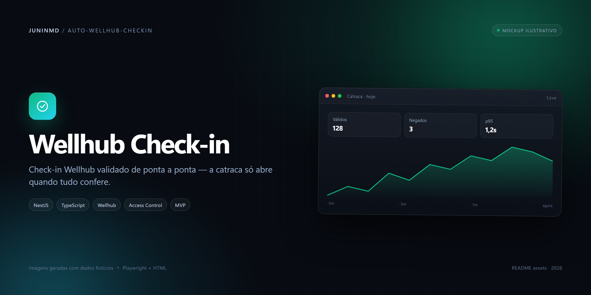
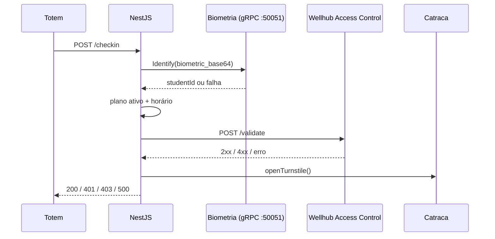
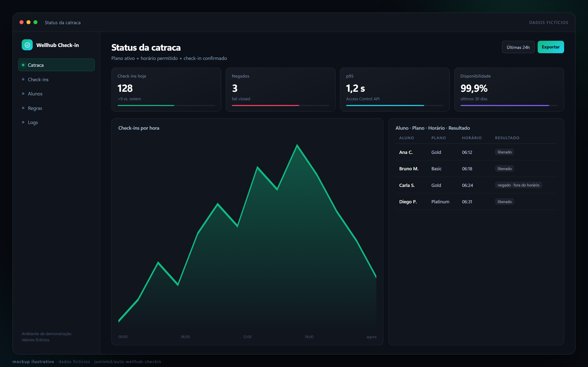
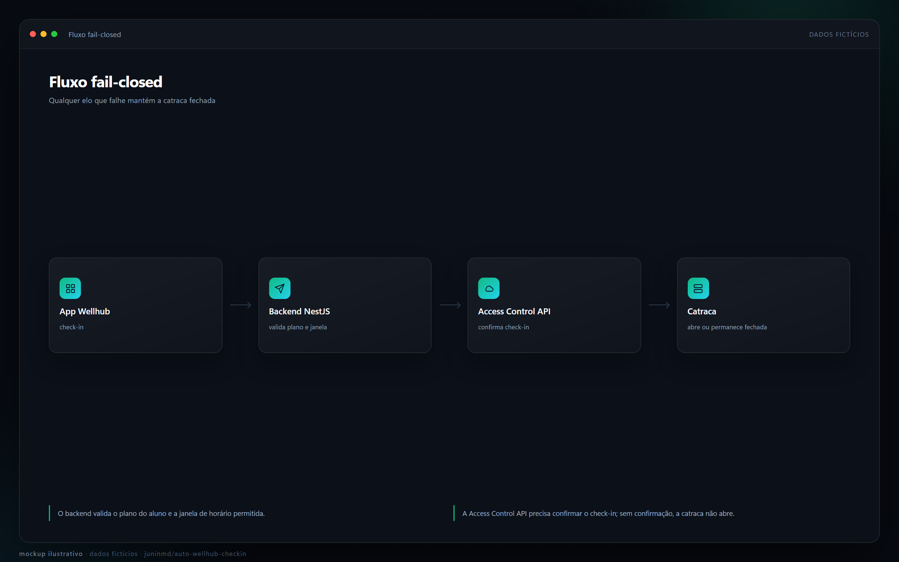

# Wellhub Check-in para Academias

<p align="center">
  
</p>

Backend em NestJS que valida o check-in feito no app Wellhub e só libera a catraca quando o plano do aluno está ativo, o horário é permitido e a Access Control API confirma que existe um check-in válido. Se qualquer elo falhar, a catraca continua fechada.

[](LICENSE)

> [!IMPORTANT]
> O repositório é um **MVP arquitetural**, não um sistema pronto para produção. O fluxo, os contratos e o tratamento de falha do Wellhub estão implementados e testados; persistência, catraca física e o microsserviço de biometria ainda são stubs. A seção [Limitações](#limitações) lista exatamente o que falta, e o [`LIMITATIONS.md`](LIMITATIONS.md) original foi preservado.

## Fluxo do check-in

1. O aluno faz o check-in no app Wellhub. O check-in tem validade curta (cerca de 20 minutos, conforme o desenho do produto).
2. O aluno se identifica no totem com face ou digital. O totem chama `POST /checkin` com o dado biométrico e o tipo.
3. O backend envia o dado ao serviço de biometria por gRPC (`BiometricService.Identify`) e recebe um `studentId` ou uma falha.
4. Com o `studentId`, consulta o cadastro do aluno e aplica as regras: plano ativo e horário permitido para o plano.
5. Se o aluno tem `gympassId`, chama `POST {WELLHUB_BASE_URL}/validate` com o Bearer token e o header `X-Gym-Id`. Sem aprovação, o acesso é negado.
6. Só então aciona a catraca, registra o check-in como `SUCCESS` e responde `200`.

Alunos sem `gympassId` (planos próprios) pulam o passo 5. O `gympassId` é opcional no cadastro, mas quando existe precisa ter exatamente 13 dígitos.

### Fail-closed

O comportamento de falha é a parte mais importante do serviço:

| Situação | Resultado |
|---|---|
| Biometria não reconhece (`success: false`) | `401 Unauthorized` — “Usuário não reconhecido” |
| Plano inativo | `403 Forbidden` — acesso negado, check-in logado como `FAILED` |
| Fora do horário permitido | `403 Forbidden` — acesso negado, check-in logado como `FAILED` |
| Wellhub responde `2xx` | Aprovado, segue para a catraca |
| Wellhub responde outro `4xx` (ex.: `400`, `404`, `422`) | Negado (`403`): não há check-in ativo |
| Wellhub responde `401`, `403` ou `5xx` | Erro tratado como indisponibilidade, não como “aluno sem check-in”: a requisição termina em `500` e a catraca não abre |
| Timeout, DNS ou rede fora | Mesmo caminho: `500`, catraca fechada |
| `gympassId` fora do padrão de 13 dígitos | Negado localmente, **sem** chamar a API |
| Catraca não confirma a abertura | `500` — “Falha de comunicação com a catraca” |

A distinção entre “negado” e “erro” é intencional: uma credencial inválida ou uma API fora do ar não podem virar acesso liberado nem ser registradas como se o aluno não tivesse feito check-in.

## API

O servidor sobe em `http://localhost:3000` (porta fixa em `src/main.ts`) e usa `ValidationPipe` global com `whitelist: true` e `transform: true`.

### `POST /students`

Cadastra um aluno. Responde `201`.

| Campo | Tipo | Regra |
|---|---|---|
| `name` | string | Obrigatório, não vazio |
| `email` | string | Obrigatório, e-mail válido |
| `planId` | string | Obrigatório, não vazio |
| `biometricHash` | string | Obrigatório; deve ser o embedding/hash, não a foto |
| `biometricType` | `"FACE"` \| `"FINGERPRINT"` | Obrigatório |
| `gympassId` | string | Opcional; exatamente 13 dígitos |

Resposta:

```json
{
  "id": "uuid-gerado",
  "name": "Nome do aluno",
  "isActive": true,
  "planId": "plan-1"
}
```

Exemplo de requisição (ilustrativo):

```bash
curl -X POST http://localhost:3000/students \
  -H 'content-type: application/json' \
  -d '{"name":"Aluno","email":"aluno@example.com","planId":"plan-1","biometricHash":"hash-ou-embedding","biometricType":"FACE","gympassId":"1234567890123"}'
```

### `POST /checkin`

Processa o check-in. Responde `200` em caso de liberação.

| Campo | Tipo | Regra |
|---|---|---|
| `biometricData` | string | Obrigatório; base64 da imagem ou hash pré-processado |
| `type` | `"FACE"` \| `"FINGERPRINT"` | Obrigatório |

Resposta de sucesso:

```json
{ "message": "Acesso Liberado", "userId": "student-id" }
```

Exemplo de requisição (ilustrativo):

```bash
curl -X POST http://localhost:3000/checkin \
  -H 'content-type: application/json' \
  -d '{"biometricData":"base64-ou-hash","type":"FACE"}'
```

> [!NOTE]
> O `type` é validado no DTO, mas o cliente gRPC envia somente `biometric_base64` no `IdentifyRequest` — o contrato proto não tem campo de tipo. Quem decide face versus digital hoje é o totem, não o backend.

Não há endpoint de saúde, autenticação, rate limiting, CORS ou anti-passback implementados.

## Configuração

Copie `gym-checkin-system/backend/.env.example` para `gym-checkin-system/backend/.env`:

| Variável | Obrigatória | Padrão | Descrição |
|---|---|---|---|
| `WELLHUB_API_TOKEN` | Sim | — | Bearer token emitido pelo Wellhub Partner Portal |
| `WELLHUB_GYM_ID` | Sim | — | Gym ID enviado no header `X-Gym-Id` |
| `WELLHUB_BASE_URL` | Não | `https://apitesting.partners.gympass.com/access/v1` | Sandbox; produção: `https://api.partners.gympass.com/access/v1` |
| `WELLHUB_TIMEOUT_MS` | Não | `5000` | Timeout da chamada ao Wellhub, em milissegundos |

`loadWellhubConfig()` valida token e Gym ID na inicialização e derruba o processo se faltarem. `WELLHUB_TIMEOUT_MS` precisa ser um número positivo; a URL perde a barra final.

## Como rodar

Pré-requisitos: Node.js 20+ e acesso ao sandbox do Wellhub (token e Gym ID). O cadastro como parceiro é feito no Partner Portal.

```bash
git clone https://github.com/juninmd/auto-wellhub-checkin.git
cd auto-wellhub-checkin

npm install                 # o postinstall instala o backend
cp gym-checkin-system/backend/.env.example gym-checkin-system/backend/.env
# preencha WELLHUB_API_TOKEN e WELLHUB_GYM_ID

npm run dev                 # nest start --watch, em http://localhost:3000
```

Scripts da raiz (todos delegam para `gym-checkin-system/backend`):

| Comando | Efeito |
|---|---|
| `npm run dev` | `nest start --watch` |
| `npm run build` | `nest build` |
| `npm start` | `node dist/main` |
| `npm test` | Jest |
| `npm run install:backend` | Instala só o backend |

No backend, além desses, existem `npm run lint` (ESLint com `--fix`), `npm run format` (Prettier) e `npm run start:debug`.

## Como funciona



| Caminho | Papel |
|---|---|
| `src/main.ts` | Bootstrap Nest, `ValidationPipe`, porta 3000 |
| `src/app.module.ts` | `ConfigModule` global, logger no-op, módulos de check-in e alunos |
| `src/checkin/` | Controller `POST /checkin`, DTO, serviço de orquestração e interface de repositório |
| `src/students/` | Controller `POST /students`, DTOs e serviço de cadastro/status |
| `src/infrastructure/wellhub/` | Config validada, contrato e cliente HTTP da Access Control API |
| `src/infrastructure/grpc/` | Cliente gRPC e contrato do serviço de biometria |
| `src/hardware/` | Implementação (stub) de abertura da catraca |
| `proto/biometrics.proto` | Contrato `BiometricService` com `Identify` e `Enroll` |

O cliente gRPC aponta para `localhost:50051` e carrega `proto/biometrics.proto`; não há variável de ambiente para esse endereço hoje. O `BiometricsClientService` transforma erro de transporte em `{ success: false }`, o que leva o check-in a `401`, não a `500`.

O cliente do Wellhub monta a URL como `{baseUrl}/validate`, envia `Authorization: Bearer`, `X-Gym-Id`, `Content-Type: application/json` e o corpo `{ "gympass_id": "..." }` (com `custom_code` opcional na assinatura do método).

## Segurança e privacidade

- **O token não vaza.** O teste do cliente verifica que a mensagem de erro de rede não contém o token; o cliente não loga headers nem corpo.
- **Biometria por representação.** O DTO documenta que a foto bruta não é armazenada — só o hash/embedding. Hoje, porém, o `biometricHash` recebido em `/students` **não é persistido em lugar algum**; o cadastro é em memória.
- **Nenhum segredo no repositório.** O `.env.example` vem vazio; o token real fica no `.env`, que é git-ignored.
- **Fail-closed, por construção.** Erros de credencial/rede do Wellhub lançam exceção antes de qualquer chamada à catraca.
- **Superfície aberta.** `POST /checkin` e `POST /students` não exigem autenticação. Não exponha o serviço fora da rede do totem sem colocar autenticação na frente.

## Desenvolvimento e testes

```bash
npm test                                  # Jest, a partir da raiz
# ou
cd gym-checkin-system/backend
npm test
npm run lint
npm run build
```

As specs cobrem o caminho feliz, biometria inválida, plano inativo, horário bloqueado, falha da catraca, erro inesperado, aluno sem `gympassId`, aprovação e negação do Wellhub, indisponibilidade da API e validação do `gympassId`. O `jest.config.js` usa `ts-jest`, ambiente `node` e coleta cobertura de `src/**/*.ts` (excluindo `main.ts`, módulos, DTOs e interfaces).

Workflows:

| Workflow | O que roda |
|---|---|
| `validate.yml` | Workflow reutilizável de validação em PRs e pushes |
| `sast.yml` | Semgrep pelo workflow compartilhado, com `fail-semgrep: false` (relatório no primeiro ciclo) |
| `security.yml` | Scan de segurança pelo workflow compartilhado, em pushes |
| `release-drafter.yml` | Notas de release |
| `dependabot-auto-merge.yml` | Auto-merge de PRs do Dependabot quando todos os checks passam |

## Imagens

> [!NOTE]
> **Mockups ilustrativos.** As telas abaixo foram geradas em HTML com dados fictícios (Playwright) e não são capturas de uma instalação real.

<p align="center">
  
  <br>
  <sub>Status da catraca — dados fictícios.</sub>
</p>

<p align="center">
  
  <br>
  <sub>Fluxo fail-closed — dados fictícios.</sub>
</p>


## Limitações

Estas são as limitações declaradas em [`LIMITATIONS.md`](LIMITATIONS.md), confirmadas no código:

- **Tudo em memória.** `StudentService` guarda apenas `gympassId` num `Map`; o status do aluno é sempre `{ isActive: true, planId: "plan-1" }`, e `isCheckinAllowedAtCurrentTime()` retorna `true` sempre. O repositório de check-in é um objeto que devolve `{ id: "log-1", ...log }` sem gravar nada. Reiniciar o processo perde cadastros e histórico.
- **Catraca é stub.** `HardwareService.openTurnstile()` retorna `true` sem falar com hardware. Não há GPIO, serial, TCP/UDP nem integração com fabricante.
- **Serviço de biometria não existe neste repositório.** Só o contrato gRPC e o cliente. Sem algo escutando em `localhost:50051`, todo check-in falha em `401`.
- **Logger no-op.** Os providers de `LoggerService` descartam as mensagens; nada vai para stdout.
- **Wellhub não homologado no sandbox.** O schema de resposta, os códigos de erro finos e webhooks não foram confirmados contra a API real; a regra atual é a do cliente: 2xx aprovado, 401/403/5xx/rede erro, demais 4xx negado.
- **Sem persistência de `gympassId`.** O ID existe só enquanto o processo vive.
- **Falha de rede do Wellhub não gera log de `FAILED`.** A exceção sobe direto para o `500`; o `logFailedCheckin` cobre apenas negações de negócio.
- **Sem Dockerfile, Compose, migrations ou CI de integração.** O repositório entrega o backend e os workflows de qualidade, não um ambiente empacotado.
- **Sem autenticação, rate limit, CORS ou anti-passback.** O `ARCHITECTURE.md` descreve Redis para anti-passback, mas isso não está implementado.

## Licença

MIT — veja [`LICENSE`](LICENSE). Copyright (c) 2026 Auto Wellhub Check-in Contributors.
